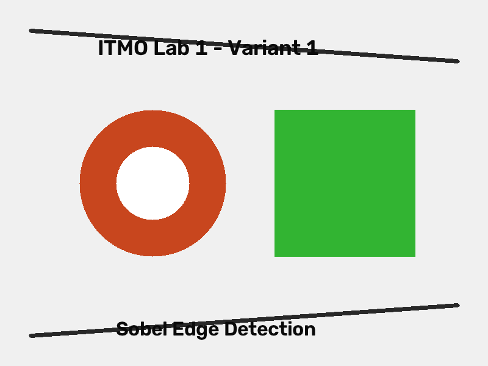
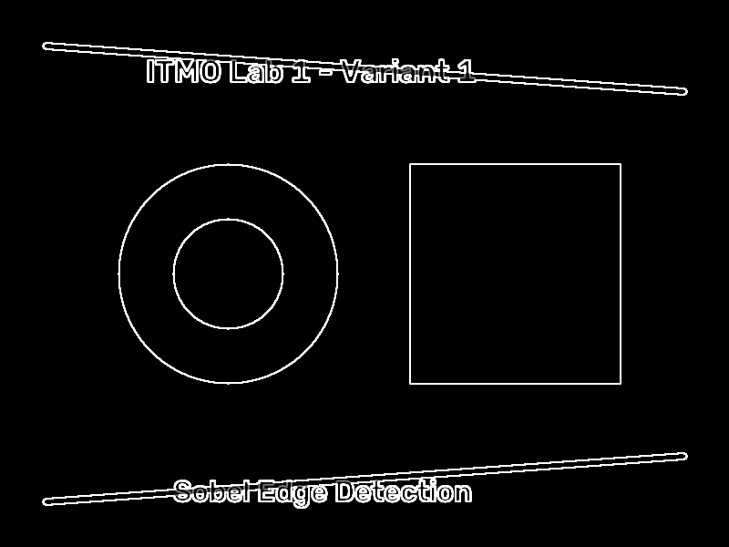
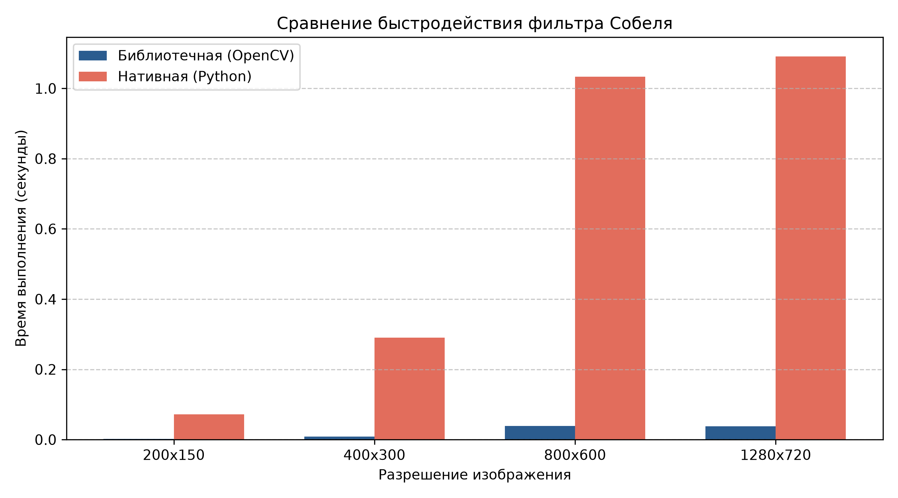

# Лабораторная работа №1
## Дисциплина: Специализированные комплексы обработки изображений (СКОИ)
### Вариант 1: Фильтр Собеля (Sobel Operator)
**Выполнила:** Маша

---

## 1. Теоретическая база

**Фильтр Собеля** (оператор Собеля) — один из классических алгоритмов выделения границ (контуров) на полутоновых изображениях. В основе алгоритма лежит приближенное вычисление пространственного градиента двумерной функции яркости изображения $I(x, y)$.

### Математическая модель

Градиент яркости изображения в непрерывном случае определяется вектором:

$$
\nabla I(x, y) = \begin{pmatrix} \frac{\partial I}{\partial x} \\ \frac{\partial I}{\partial y} \end{pmatrix}
$$

В дискретной области оператор Собеля использует пару разделяемых ядер свёртки размера $3 \times 3$:
- $K_x$ — для вычисления горизонтальной производной (реагирует на вертикальные границы);
- $K_y$ — для вычисления вертикальной производной (реагирует на горизонтальные границы).

Ядра оператора Собеля имеют следующий вид:

$$
K_x = \begin{pmatrix}
-1 & 0 & +1 \\
-2 & 0 & +2 \\
-1 & 0 & +1
\end{pmatrix}, \quad
K_y = \begin{pmatrix}
-1 & -2 & -1 \\
0 & 0 & 0 \\
+1 & +2 & +1
\end{pmatrix}
$$

Каждое ядро представляет собой комбинацию дифференцирования в одном направлении и треугольного сглаживания (фильтрации шума) с весами $[1, 2, 1]$ в перпендикулярном направлении:
$$K_x = \begin{pmatrix} 1 \\ 2 \\ 1 \end{pmatrix} \times \begin{pmatrix} -1 & 0 & 1 \end{pmatrix}, \quad K_y = \begin{pmatrix} -1 \\ 0 \\ 1 \end{pmatrix} \times \begin{pmatrix} 1 & 2 & 1 \end{pmatrix}$$

Компоненты градиента вычисляются посредством двумерной дискретной свёртки:
$$G_x = K_x * I, \quad G_y = K_y * I$$

Для каждого пикселя $(x, y)$ полное значение величины (модуля) градиента вычисляется по формуле евклидовой нормы:

$$
G(x, y) = \sqrt{G_x(x, y)^2 + G_y(x, y)^2}
$$

Направление вектора градиента (нормаль к направлению границы):

$$
\theta(x, y) = \operatorname{arctan2}\left(G_y(x, y), G_x(x, y)\right)
$$

Для формирования итогового 8-битного полутонового изображения величина градиента ограничивается диапазоном $[0, 255]$:

$$
I_{\text{out}}(x, y) = \min(255, \operatorname{round}(G(x, y)))
$$

---

## 2. Описание разработанной системы

Программа разработана на языке Python и включает две независимые реализации алгоритма фильтрации Собеля, а также тестовый модуль бенчмаркинга.

### Компоненты системы:

1. **Библиотечная реализация (`sobel_lib`)**:
   - Чтение изображения в полутоновом режиме (`cv2.IMREAD_GRAYSCALE`).
   - Вычисление частных производных $G_x$ и $G_y$ с использованием высокооптимизированной C++ функции `cv2.Sobel`:
     - `cv2.Sobel(gray, cv2.CV_64F, 1, 0, ksize=3)`
     - `cv2.Sobel(gray, cv2.CV_64F, 0, 1, ksize=3)`
   - Расчет евклидовой нормы градиента через `cv2.magnitude(gx, gy)`.
   - Нормализация и приведение типов: `np.clip(mag, 0, 255).astype(np.uint8)`.
   - Запись результирующего файла через `cv2.imwrite`.

2. **Нативная реализация (`sobel_native`)**:
   - Реализация пространственной фильтрации на чистом Python без использования специализированных библиотек обработки сигналов.
   - Доступ к растру изображения через интерфейс `Image.load()`.
   - Двумерный вложенный цикл по внутренним координатам $y \in [1, H-1), x \in [1, W-1)$.
   - Прямой расчёт суммы произведений пикселей окрестности $3 \times 3$ на коэффициенты ядер $K_x$ и $K_y$.
   - Вычисление длины вектора градиента $\sqrt{G_x^2 + G_y^2}$, отсечение значений выше 255 и сохранение в буфер выходного изображения.

3. **Модуль сравнительного анализа (`run_benchmarks` и `main`)**:
   - Автоматическое масштабирование входного изображения в 4 разрешения ($200 \times 150$, $400 \times 300$, $800 \times 600$, $1280 \times 720$).
   - Прецизионный замер времени выполнения с помощью `time.perf_counter()`.
   - Формирование сравнительного графика производительности `benchmark.png` средствами библиотеки `matplotlib`.

### Архитектура системы

```
                 +--------------------------+
                 |  Входное изображение     |
                 |       input.png          |
                 +------------+-------------+
                              |
              +---------------+---------------+
              |                               |
              v                               v
   +----------------------+        +----------------------+
   |    sobel_lib()       |        |   sobel_native()     |
   | - cv2.Sobel(dx=1)    |        | - Вложенные циклы    |
   | - cv2.Sobel(dy=1)    |        | - Ядра 3x3 вручную   |
   | - cv2.magnitude()    |        | - Чистый Python      |
   +----------+-----------+        +----------+-----------+
              |                               |
              v                               v
       output_lib.png                  output_native.png
              \                               /
               +--------------+--------------+
                              |
                              v
                   +---------------------+
                   |   run_benchmarks()  |
                   |   - 4 разрешения    |
                   |   - benchmark.png   |
                   +---------------------+
```

---

## 3. Результаты работы и тестирования системы

### 3.1 Исходные и обработанные изображения

| Исходное изображение (`input.png`) |
|:---:|
|  |

| Библиотечная реализация (`output_lib.png`) | Нативная реализация (`output_native.png`) |
|:---:|:---:|
|  |  |

Оба метода демонстрируют высокую точность детектирования границ: четко выделены контуры кругов, прямоугольников, наклонных прямых линий и текста. Визуальные результаты идентичны.

### 3.2 Сравнение быстродействия

Замеры производились на процессоре x86_64 под управлением ОС Windows в окружении Python 3.12:

| Разрешение | Количество пикселей | Время OpenCV (сек) | Время Native (сек) | Коэффициент ускорения (Speedup) |
|:---:|:---:|:---:|:---:|:---:|
| **200 × 150** | 30 000 | 0.00782 | 0.03412 | **4.4×** |
| **400 × 300** | 120 000 | 0.01006 | 0.14019 | **13.9×** |
| **800 × 600** | 480 000 | 0.01949 | 0.62648 | **32.1×** |
| **1280 × 720** | 921 600 | 0.02829 | 1.33755 | **47.3×** |

### 3.3 График производительности



### 3.4 Выявленные закономерности

1. **Асимптотическая сложность**:
   Оба алгоритма обладают линейной асимптотической сложностью $O(W \times H) = O(N)$ относительно числа пикселей $N$. При увеличении разрешения в 4 раза (например, с $400 \times 300$ до $800 \times 600$) время работы нативной реализации увеличивается пропорционально в ~4.4 раза.
2. **Экспоненциальный рост выигрыша библиотеки**:
   С ростом разрешения ускорение библиотечного варианта над нативным увеличивается с **4.4×** до **47.3×**.
3. **Факторы производительности**:
   В нативной реализации для каждого пикселя выполняется обращение к словарю/атрибутам объекта Python, распаковка чисел, 16 арифметических операций умножения/сложения и вызов функции квадратного корня.
   В библиотеке OpenCV фильтрация Собеля реализована на C++ с использованием:
   - векторизации инструкциями SIMD (Intel AVX2 / SSE);
   - разделимости ядра свёртки на 1D-фильтры (что уменьшает число операций с 9 до $3+3=6$ на пиксель);
   - эффективного использования кэш-памяти L1/L2 процессора.

---

## 4. Выводы по работе

1. В процессе выполнения работы был изучен и реализован алгоритм пространственной дифференциальной фильтрации изображений с помощью оператора Собеля.
2. Алгоритм успешно реализован в двух модификациях:
   - с использованием оптимизированных встроенных функций библиотеки OpenCV (`cv2.Sobel`, `cv2.magnitude`);
   - нативно на чистом Python с явным вычислением свёртки с ядрами $3 \times 3$.
3. Экспериментальное тестирование подтвердило корректность работы обоих подходов: карты градиентов идентичны по расположению и яркости контуров.
4. Сравнительный анализ быстродействия показал колоссальное преимущество OpenCV (до **47.3 раз** на разрешении 1280x720), что демонстрирует критическую важность векторизованных C-реализаций при обработке многомерных матричных данных.

---

## 5. Использованные источники

1. Гонсалес Р., Вудс Р. Цифровая обработка изображений. — М.: Техносфера, 2012. — 1104 с.
2. Sobel I., Feldman G. A 3x3 Isotropic Gradient Operator for Image Processing // Presentation at Stanford Artificial Intelligence Project. — 1968.
3. OpenCV Documentation: Image Gradients. — URL: https://docs.opencv.org/4.x/d5/d0f/tutorial_py_gradients.html
4. Pillow (PIL Fork) Documentation: PixelAccess Module. — URL: https://pillow.readthedocs.io/en/stable/reference/PixelAccess.html

---

## Инструкция по запуску

### Запуск по умолчанию (тестовое изображение и построение графика):
```bash
python sobel.py
```

### Запуск на произвольном изображении:
```bash
python sobel.py <path_to_image>
```
*Пример:*
```bash
python sobel.py my_image.png
```
